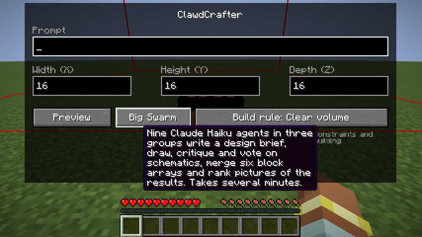
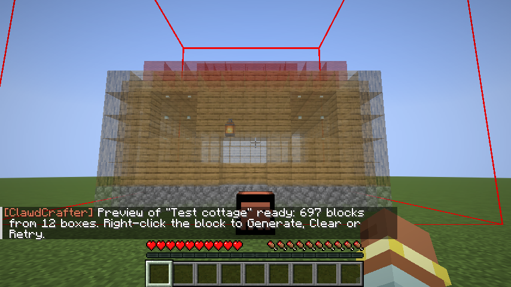
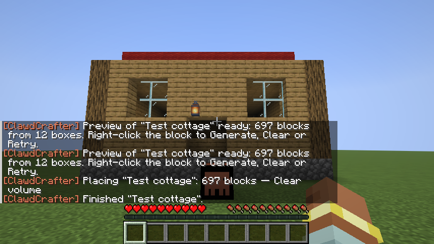
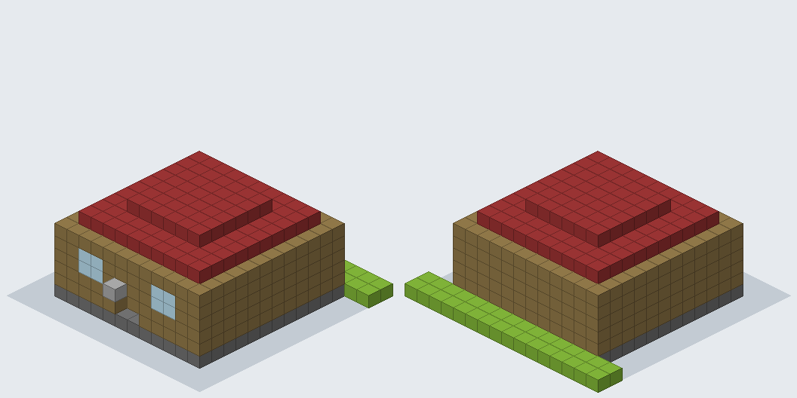
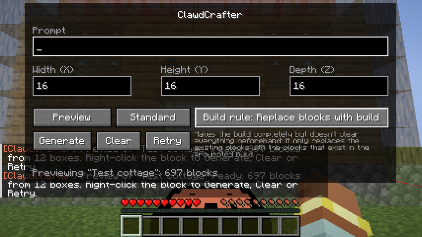

# ClawdCrafter

A Minecraft mod that adds one block that turns a written prompt into a 3D build, generated by Claude.

- Type what you want and set the size of the area it may fill (X × Y × Z, 16 × 16 × 16 by default).
- Choose how it is designed: **Standard** (one Claude request, about a minute) or **Big Swarm** (nine Claude Haiku agents that brief, draw, critique and vote, several minutes).
- Press **Preview** to see the build as see-through ghost blocks inside a red boundary.
- If you like it, press **Generate** to build it for real.

| Screen | Preview (ghost blocks + boundary) | After Generate |
|---|---|---|
|  |  |  |

These screenshots come from the automated client test, which uses a hand-written test build instead of a Claude reply.

## Requirements

| | Version |
|---|---|
| Minecraft (Java Edition) | 26.3 |
| Fabric Loader | 0.19.5 or newer |
| Fabric API | 0.161.0+26.3 or newer |
| Java | 25 |
| Anthropic API key | from [console.anthropic.com](https://console.anthropic.com) |

The Anthropic Java SDK is bundled inside the mod jar (about 35 MB), so there is nothing else to install.

## Install

1. Install Fabric Loader and Fabric API for Minecraft 26.3.
2. Put `clawdcrafter-<version>.jar` in the `mods/` folder. For multiplayer, the server and every player need it.
3. Start the game (or server) once. This creates `config/clawdcrafter.json`.
4. Put your API key in that file (see below) and restart.

## Configuration: `config/clawdcrafter.json`

The **server** reads this file; in singleplayer that is your own game. The API key is never sent to players.

| Key | Default | Meaning |
|---|---|---|
| `apiKey` | `""` | Your Anthropic API key. If empty, the `ANTHROPIC_API_KEY` environment variable is used. |
| `model` | `claude-sonnet-5-5` | The Claude model for the Standard method. |
| `effort` | `medium` | `low`, `medium`, `high`, `xhigh` or `max`. Higher is slower and costs more, but builds are more detailed. |
| `swarmModel` | `claude-haiku-5-5` | The model each of the nine Big Swarm agents uses. |
| `swarmEffort` | `medium` | Effort for every Big Swarm agent. |
| `maxDimension` | `64` | Largest size allowed in each size box (at most 128). |
| `blocksPerTick` | `1024` | How many blocks are placed per game tick (20 ticks = 1 second). Lower it if the server lags while building. |
| `opOnly` | `false` | Only server operators may use the block. Recommended on public servers, since every build costs API credit. |

## Usage

1. Take the **ClawdCrafter** block from the *Functional Blocks* creative tab, or craft it. The recipe is a placeholder: orange terracotta in the corners, black concrete on the sides, a diamond in the middle.
2. Place it and right-click it. A thin **red outline** shows the area the build may fill. It follows the size boxes and the direction you're facing.
3. Type a prompt, e.g. *"a cozy oak cabin with a stone chimney"*, and adjust the sizes if you like.
4. Pick the method with the button next to Preview (hover it for a description): **Standard** or **Big Swarm** (see below).
5. Press **Preview**. After a wait (usually under a minute for Standard, several minutes for Big Swarm), the build appears as **ghost blocks**:
   - Only you can see them, and nothing has been placed yet.
   - You can keep the screen open or close it and walk around.
   - When the preview is ready, these buttons appear:

| Button | What it does |
|---|---|
| **Generate** | Builds exactly the build you previewed. Claude isn't asked again. |
| **Clear** | Removes the ghost blocks. |
| **Retry** | Asks Claude again with the same prompt and method, for a different version. |

The build always appears **on the far side of the block, facing you**. It is centered on the block, and its floor is level with the block:

```
        [ build area X × Y × Z ]
                  ▲
             [ClawdCrafter]
                  ▲
                 you
```

Chat messages tell you when a preview is ready, when a build starts and finishes, and about any problems. Each block remembers its last prompt, sizes, method and build rule.

### Big Swarm

Big Swarm designs the build with nine agents (Claude Haiku 5.5 at medium effort by default) in three groups of three: group 1 (A1–A3), group 2 (B1–B3) and group 3 (C1–C3). Agents pass their work to each other, and chat shows each step as it starts:

| Step | Who | What happens |
|---|---|---|
| 1 | Group 1 | Each writes a long, detailed design brief for your prompt and size; A1 critiques the three drafts and merges them into one. |
| 2 | Group 2 | Each draws its own block-by-block schematic from the brief, layer by layer. |
| 3 | Group 2 | Each critiques the other two schematics. |
| 4 | Group 2 | Each improves its own schematic using the two critiques it got. |
| 5 | Group 3 | Each assesses the three schematics, reads the others' assessments, then ranks them. The most points wins. |
| 6 | Group 1 | Each checks the winner against the brief; A1 applies the fixes and final tweaks. |
| 7 | Groups 1 and 2 | Each of the six turns the final schematic into a 3D array of blocks. |
| 8 | Group 3 | A seventh array takes the most common block in every cell (4 × oak log beats 1 spruce + 1 birch). On a tie, group 3 votes. |
| 9 | The mod | All seven arrays are drawn as 3D pictures, shuffled and labelled A–G, so nobody knows which is which. |
| 10 | All nine | Each ranks its top three pictures (3, 2, 1 points) by accuracy to the prompt and build quality. The winner becomes the preview. |



- **Pictures:** models can't draw pictures, so the mod renders step 9 itself: an isometric view of the front and one of the back, in the blocks' map colours.
- **Arrays:** each 3D array is written as `/fill`-style boxes (single blocks where needed), which the mod expands into the full grid before the vote.
- **Saved runs:** every run saves a transcript (every brief, schematic, critique, vote and ranking) and the seven pictures in `clawdcrafter/swarm/<date-time>/` in the game (or server) folder. The final chat message names the folder.
- **Failures:** if one agent's request fails, the swarm continues without it. It stops only when a whole step fails.
- **Cost and time:** about 44 requests per run. With Claude Haiku 5.5 a 16³ build should cost well under a dollar and take several minutes. These are estimates; Big Swarm hasn't been run against the live API yet.

### Build rules

The **Build rule** button, to the right of Preview, decides what Generate does with blocks that are already in the build area. Click it to switch between the three rules. The current rule's description is shown under the button.

| Build rule | What Generate does |
|---|---|
| **Clear volume** (default) | Clears out all the blocks in the area, then builds. |
| **Replace blocks with build** | Builds the whole thing, including its open spaces such as rooms and doorways. Blocks outside the build are left alone. |
| **Build only where possible** | Places the build only where there is room. Air, grass, flowers, snow, liquids and torches count as room. Nothing else is replaced or removed. |

The rule is applied when you press Generate, so you can switch rules after previewing without asking Claude again.



### What happens to things already in the build area

**Blocks are broken, not deleted.**
- Anything that gets removed or replaced drops what it would drop if you broke it by hand: seeds from grass, the torch itself, a chest and everything inside it.
- All of it, plus any items already lying in the area, is merged into stacks. They pop out **on top of the ClawdCrafter block** when the build finishes.
- Liquids are simply replaced.
- Bedrock, portals and other unbreakable blocks are never touched.

**Falling blocks:**
- Sand, gravel, anvils or concrete powder sitting on the top edge of the area are broken into items if the build would leave them hanging.
- Anything that still falls into the area is caught and turned into an item.

**Mobs, players, boats and minecarts** that would end up inside new blocks are lifted straight up to the first free space. For example, a cow standing where the floor goes ends up standing on the floor.

**Item frames and paintings** that lose the wall they hang on drop as items.

**Lag protection:** if clearing a huge area (for example 64³ of solid stone) would drop more than 256 stacks of loot, the most plentiful kinds are dropped last, and whatever goes past the limit is discarded. Items that were already items, such as chest contents, are never discarded. The chat message says how many stacks were discarded.

**Areas the mod won't touch:**
- Protected spawn areas and anything outside the world border.
- Areas that aren't loaded. Generate won't start until the whole area is loaded; it asks you to move closer. If part of the area unloads mid-build, the skipped blocks are reported.

**Who can build:** you must be within normal reach of the block, and able to build in your game mode, so not adventure or spectator.

## Limitations

- The crafting recipe is a placeholder.
- Neither method has been tried against the live Claude API yet (no API key was available while building it); both are tested offline.
- No undo, no in-game settings screen, and no support for land-claim or protection mods.
- Builds may use any block a survival player could get, including TNT, lava and fire. Use `opOnly` on public servers.
- You see one preview at a time, and only your own.
- Previews and unfinished builds aren't saved. After a server restart, press Preview again.
- If the server stops mid-build, the rest of the build isn't placed. Items collected so far are still dropped.
- No license has been chosen yet.

## Documentation

| File | For |
|---|---|
| [`docs/DEVELOPMENT.md`](docs/DEVELOPMENT.md) | Developers: building, testing, how it works, and notes on Minecraft 26.3 APIs |
| [`docs/CHANGELOG.md`](docs/CHANGELOG.md) | What changed, version by version |
| [`docs/HANDOFF.md`](docs/HANDOFF.md) | A self-contained briefing for continuing the project in a new chat or session |
| [`docs/big-swarm-prompt.md`](docs/big-swarm-prompt.md) | A standalone prompt for testing the Big Swarm idea in another Claude chat (32³ max, ends in an image) |

Quick start for developers (Java 25): `./gradlew build` compiles the mod, runs the automated tests and writes the jar to `build/libs/`.
