# Big Swarm run: medieval stone watchtower, 16 × 16 × 16 (2026-10-23)

A full run of the ten-step Big Swarm ([prompt](../../big-swarm-prompt.md)) with nine Haiku subagents, coordinated by Claude in a Claude Code session.

- **Request:** "a medieval stone watchtower with a wooden roof", 16 × 16 × 16 ([00-request.md](00-request.md)). The rules every agent got are in [00-rules.md](00-rules.md).
- **How the agents communicated:** every message an agent received is saved in [`tasks/`](tasks) (exact text). Every answer is the file it wrote in the step folders. Agents passed work to each other only through these files.
- **Winner:** option F, A3's array, 24 points (8 of 9 first places). Final images are at the bottom.

## Final images (step 10, by the coordinator)

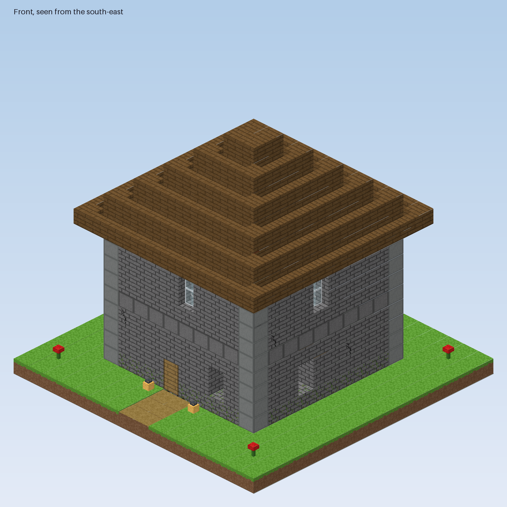
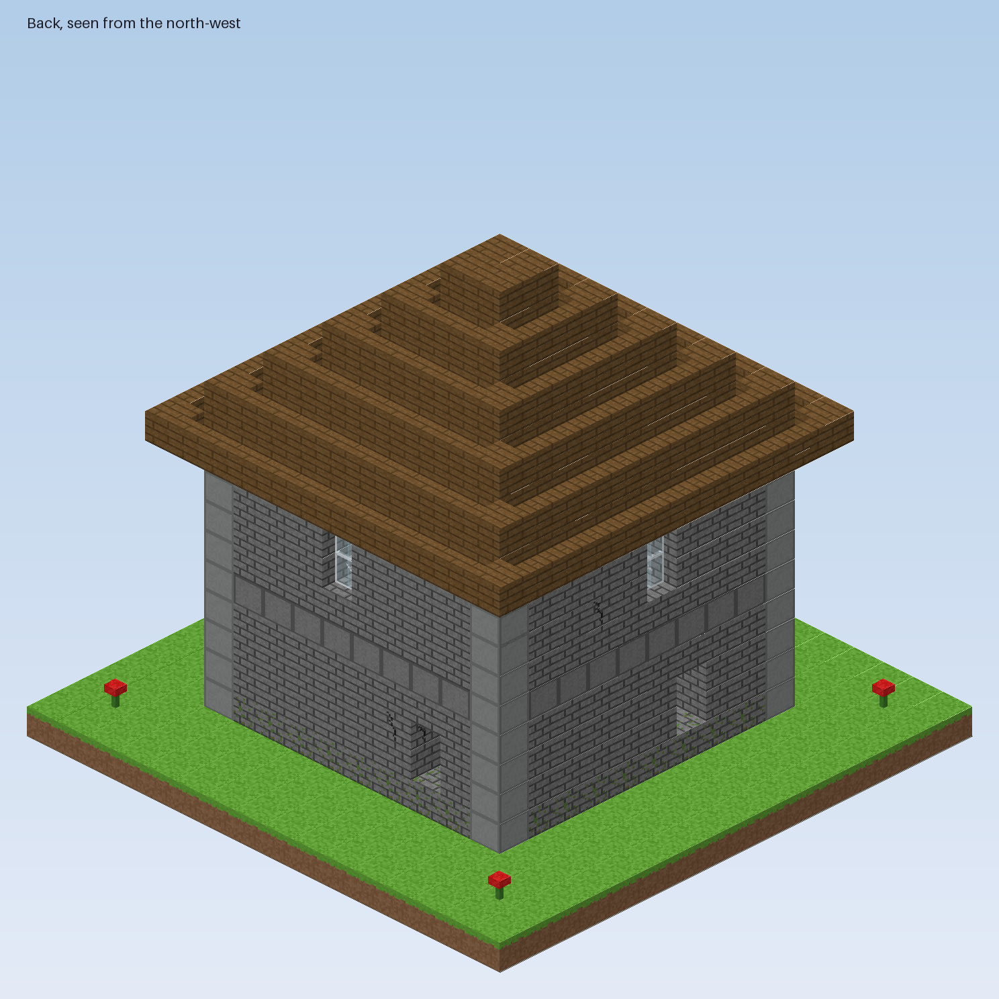
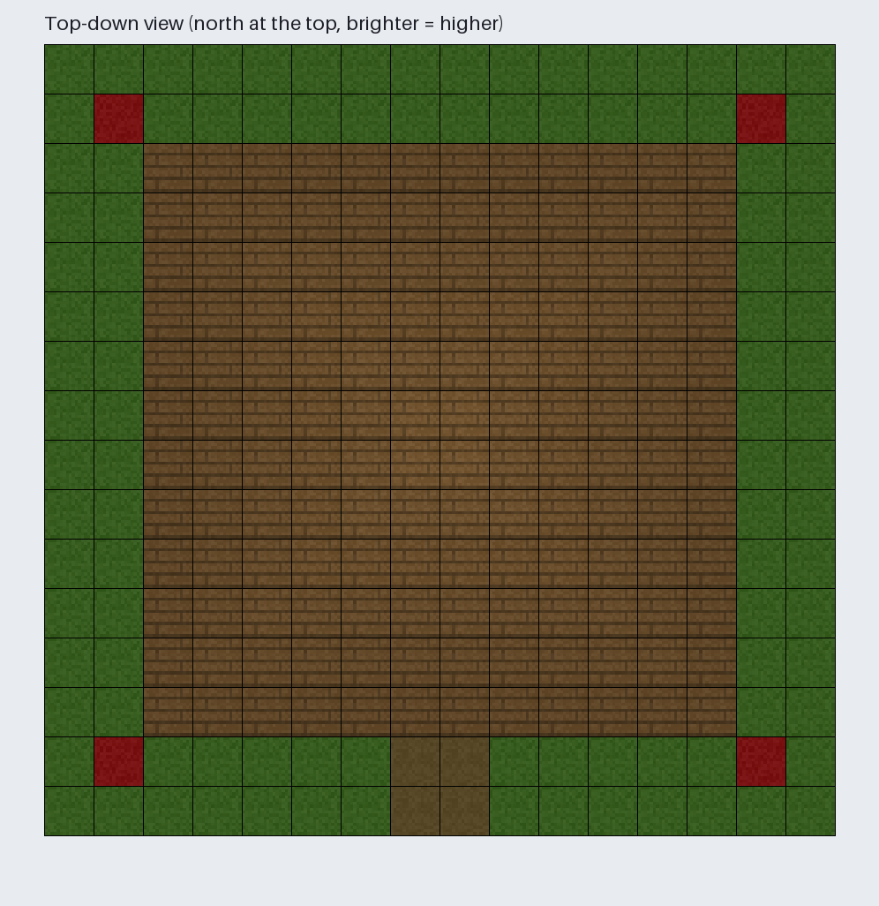
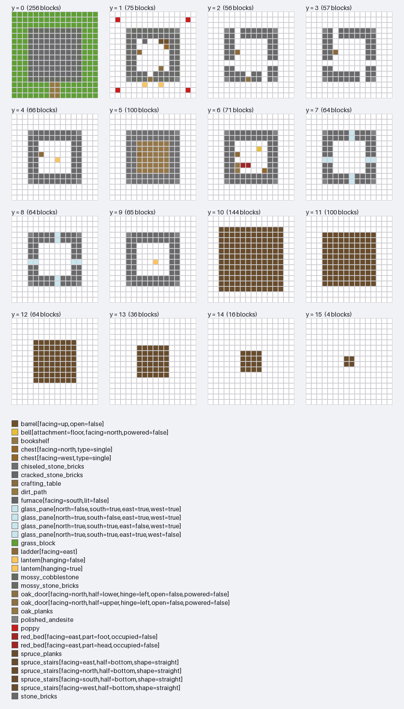

Final array: [final/final-array.json](final/final-array.json). Renderer: [final/scripts/render_final.py](final/scripts/render_final.py).

## Every step

### 1a. Design brief drafts (A1, A2, A3 in parallel)

- **Messages sent:** [1a-A1.md](tasks/1a-A1.md), [1a-A2.md](tasks/1a-A2.md), [1a-A3.md](tasks/1a-A3.md)
- **Answers:** [A1-draft.md](01-brief/A1-draft.md), [A2-draft.md](01-brief/A2-draft.md), [A3-draft.md](01-brief/A3-draft.md)

### 1b. Each designer critiques the other two drafts

- **Messages sent:** [1b-A1.md](tasks/1b-A1.md), [1b-A2.md](tasks/1b-A2.md), [1b-A3.md](tasks/1b-A3.md)
- **Answers:** [A1-critique.md](01-brief/A1-critique.md), [A2-critique.md](01-brief/A2-critique.md), [A3-critique.md](01-brief/A3-critique.md)

### 1c. A1 merges drafts and critiques into one brief

- **Messages sent:** [1c-A1.md](tasks/1c-A1.md)
- **Answers:** [brief.md](01-brief/brief.md)

### 2. Three separate schematics with images (B1, B2, B3)

- **Messages sent:** [2-B1.md](tasks/2-B1.md), [2-B2.md](tasks/2-B2.md), [2-B3.md](tasks/2-B3.md)
- **Answers:** [B1.md](02-schematics/B1.md), [B2.md](02-schematics/B2.md), [B3.md](02-schematics/B3.md)

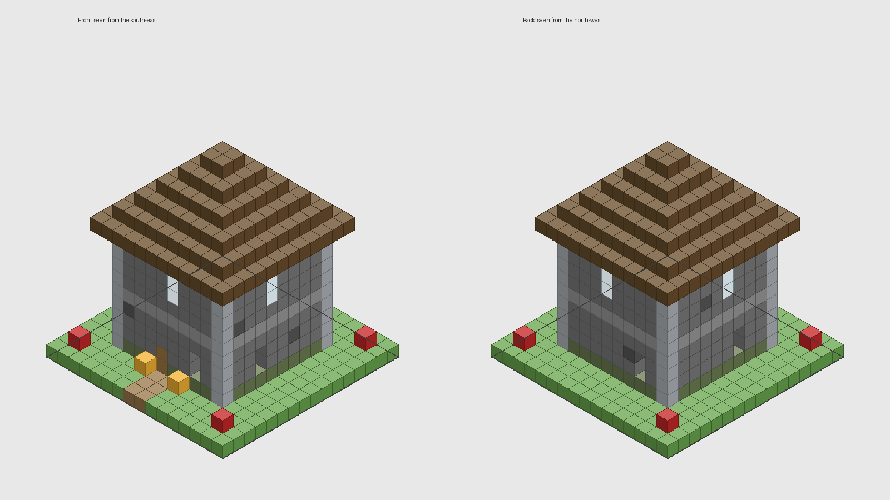
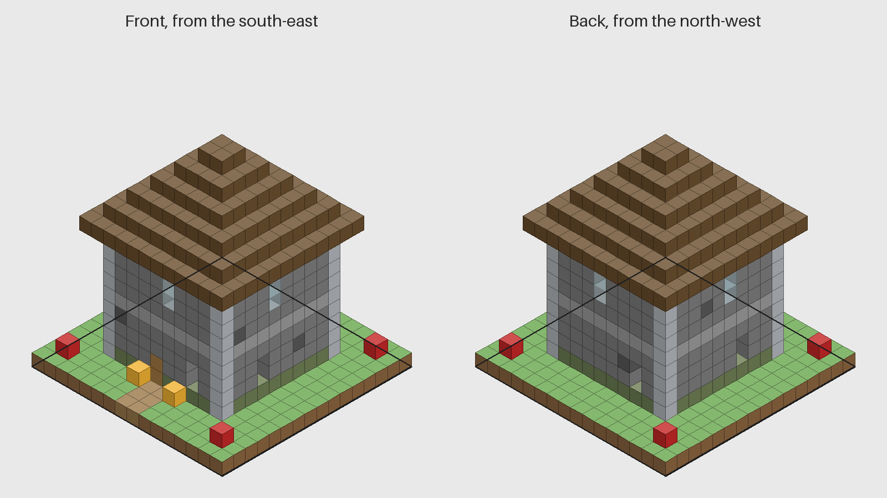
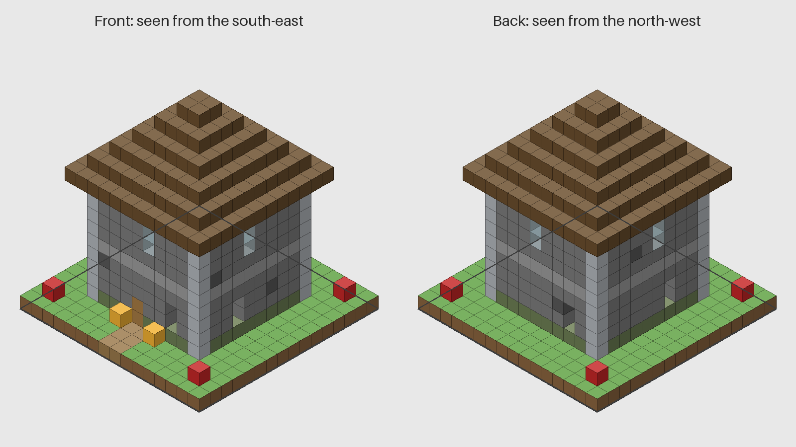

### 3. Trade and critique (six critiques)

- **Messages sent:** [3-B1.md](tasks/3-B1.md), [3-B2.md](tasks/3-B2.md), [3-B3.md](tasks/3-B3.md)
- **Answers:** [B1-on-B2.md](03-critiques/B1-on-B2.md), [B1-on-B3.md](03-critiques/B1-on-B3.md), [B2-on-B1.md](03-critiques/B2-on-B1.md), [B2-on-B3.md](03-critiques/B2-on-B3.md), [B3-on-B1.md](03-critiques/B3-on-B1.md), [B3-on-B2.md](03-critiques/B3-on-B2.md)

### 4. Each builder improves its own schematic

- **Messages sent:** [4-B1.md](tasks/4-B1.md), [4-B2.md](tasks/4-B2.md), [4-B3.md](tasks/4-B3.md)
- **Answers:** [B1.md](04-improved/B1.md), [B2.md](04-improved/B2.md), [B3.md](04-improved/B3.md)

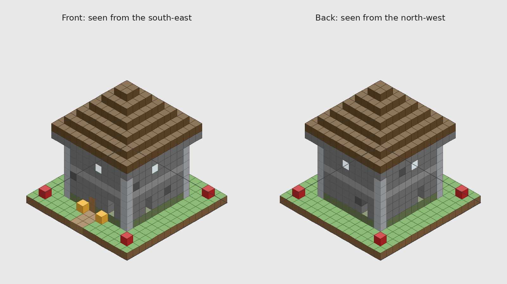
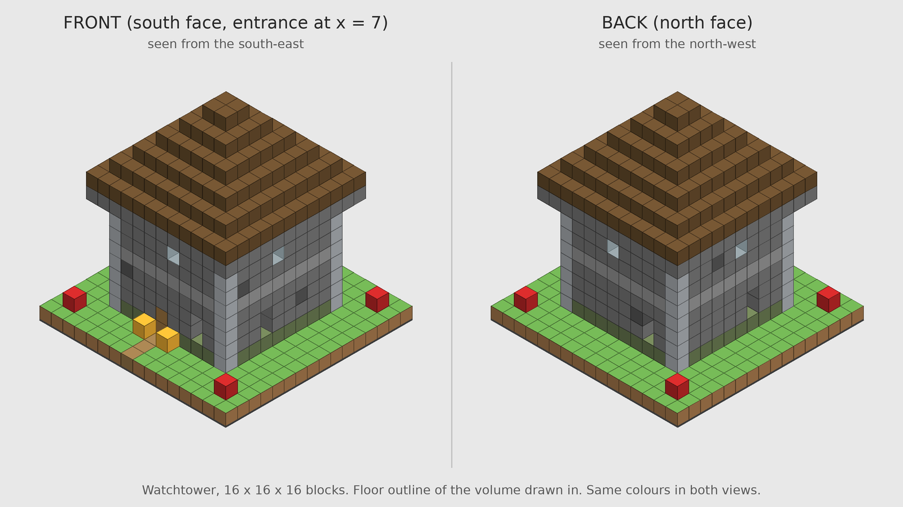
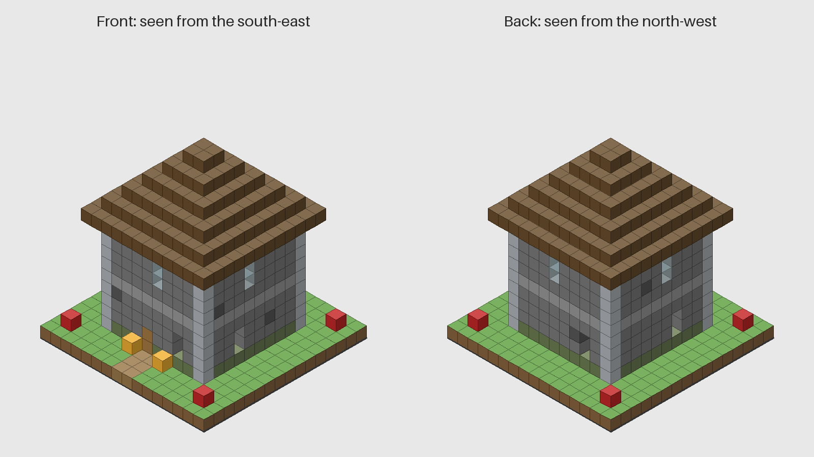

### 5a. Judges assess Schematic 1-3 (C1, C2, C3)

- **Messages sent:** [5a-C1.md](tasks/5a-C1.md), [5a-C2.md](tasks/5a-C2.md), [5a-C3.md](tasks/5a-C3.md)
- **Answers:** [C1-assessment.md](05-vote/C1-assessment.md), [C2-assessment.md](05-vote/C2-assessment.md), [C3-assessment.md](05-vote/C3-assessment.md)

### 5b. Discussion and vote

- **Messages sent:** [5b-C1.md](tasks/5b-C1.md), [5b-C2.md](tasks/5b-C2.md), [5b-C3.md](tasks/5b-C3.md)
- **Answers:** [C1-vote.md](05-vote/C1-vote.md), [C2-vote.md](05-vote/C2-vote.md), [C3-vote.md](05-vote/C3-vote.md)

### 6a. Group 1 reviews the winner against the brief

- **Messages sent:** [6a-A1.md](tasks/6a-A1.md), [6a-A2.md](tasks/6a-A2.md), [6a-A3.md](tasks/6a-A3.md)
- **Answers:** [A1-review.md](06-final/A1-review.md), [A2-review.md](06-final/A2-review.md), [A3-review.md](06-final/A3-review.md)

### 6b. A1 writes the final schematic

- **Messages sent:** [6b-A1.md](tasks/6b-A1.md)
- **Answers:** [final-schematic.md](06-final/final-schematic.md)

### 7. Six 3D arrays (A1-A3, B1-B3 in parallel)

- **Messages sent:** [7-A1.md](tasks/7-A1.md), [7-A2.md](tasks/7-A2.md), [7-A3.md](tasks/7-A3.md), [7-B1.md](tasks/7-B1.md), [7-B2.md](tasks/7-B2.md), [7-B3.md](tasks/7-B3.md)
- **Answers:** [A1.json](07-arrays/A1.json), [A2.json](07-arrays/A2.json), [A3.json](07-arrays/A3.json), [B1.json](07-arrays/B1.json), [B2.json](07-arrays/B2.json), [B3.json](07-arrays/B3.json)

### 8a. Majority array (C1, C2, C3 each compute it)

- **Messages sent:** [8a1-C1.md](tasks/8a1-C1.md), [8a1-C2.md](tasks/8a1-C2.md), [8a1-C3.md](tasks/8a1-C3.md)
- **Answers:** [C1-majority.json](08-consensus/C1-majority.json), [C1-ties.json](08-consensus/C1-ties.json), [C2-majority.json](08-consensus/C2-majority.json), [C2-ties.json](08-consensus/C2-ties.json), [C3-majority.json](08-consensus/C3-majority.json), [C3-ties.json](08-consensus/C3-ties.json), [consensus.json](08-consensus/consensus.json), [result.md](08-consensus/result.md), [scripts-C1](08-consensus/scripts-C1), [scripts-C2](08-consensus/scripts-C2)

### 8b. Blind visual reconstructions (C1: A-C, C2: D-E, C3: F-G)

- **Messages sent:** [8b-C1.md](tasks/8b-C1.md), [8b-C2.md](tasks/8b-C2.md), [8b-C3.md](tasks/8b-C3.md)
- **Answers:** [option-A.json](09-images/option-A.json), [option-B.json](09-images/option-B.json), [option-C.json](09-images/option-C.json), [option-D.json](09-images/option-D.json), [option-E.json](09-images/option-E.json), [option-F.json](09-images/option-F.json), [option-G.json](09-images/option-G.json)

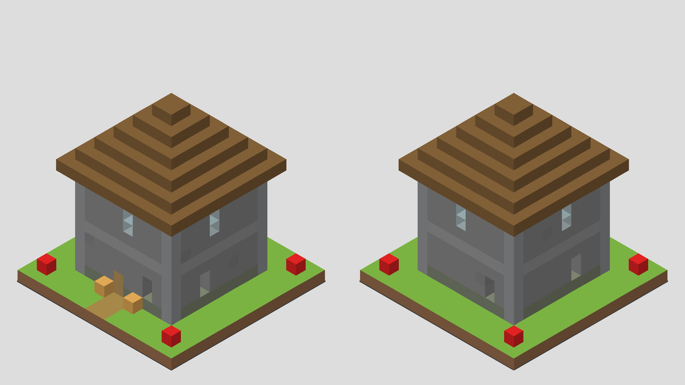

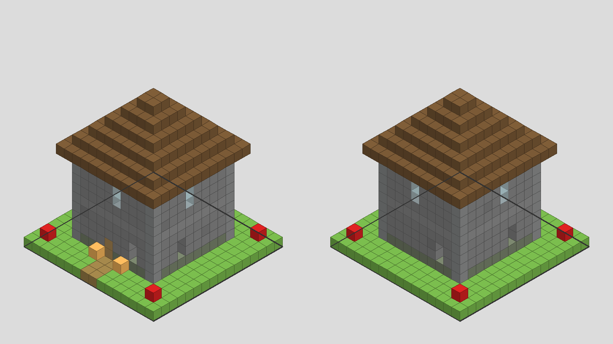

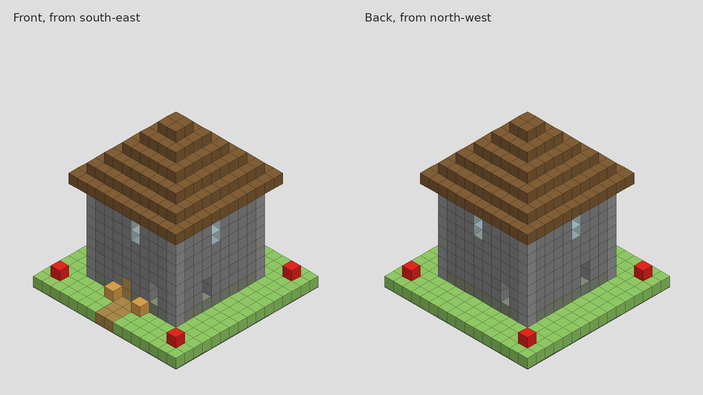

### 9. All nine rank the seven pictures

- **Messages sent:** [9-A1.md](tasks/9-A1.md), [9-A2.md](tasks/9-A2.md), [9-A3.md](tasks/9-A3.md), [9-B1.md](tasks/9-B1.md), [9-B2.md](tasks/9-B2.md), [9-B3.md](tasks/9-B3.md), [9-C1.md](tasks/9-C1.md), [9-C2.md](tasks/9-C2.md), [9-C3.md](tasks/9-C3.md)
- **Answers:** [A1.json](10-ranking/A1.json), [A2.json](10-ranking/A2.json), [A3.json](10-ranking/A3.json), [B1.json](10-ranking/B1.json), [B2.json](10-ranking/B2.json), [B3.json](10-ranking/B3.json), [C1.json](10-ranking/C1.json), [C2.json](10-ranking/C2.json), [C3.json](10-ranking/C3.json), [result.md](10-ranking/result.md)

- **Step 5 result:** [05-vote/result.md](05-vote/result.md). The key (which number was which builder) is in [05-vote/key.json](05-vote/key.json).
- **Step 8a result:** [08-consensus/result.md](08-consensus/result.md).
- **Step 9 result and key:** [10-ranking/result.md](10-ranking/result.md), [09-images/key.json](09-images/key.json).

## What happened, honestly

- **Model and effort:**
  - The agents ran on the session's "haiku" subagent model.
  - The exact Haiku version couldn't be chosen or verified from here, and effort couldn't be set to low.
  - Agents were started fresh for each step, with no memory of earlier steps; they read their earlier work from the files.
- **At most 8 agents at once:** in step 9, eight rankers ran together and then the ninth.
- **The brief already contained the answer.** A1's merged brief (12,400 words) included exact layer grids and a JSON array made by a generator script. Everything after that converged on it:
  - all three schematics followed it;
  - the vote was unanimous for B3's (schematic 1);
  - group 1 found no block fixes;
  - all six arrays came out identical, cell for cell.
- **No real merge or tie vote.** With six identical arrays, step 8a had 0 ties (C1 flagged this) and the tie vote was skipped.
- **The ranking judged render style, not designs.** All seven options were the same build, so the step 9 points only reflect how each judge drew it. C3's style (block grid and labels, options F and G) won.
- **Blinding gaps:**
  - In step 5, the schematic files' first lines named their authors (C1 noticed).
  - In step 8b, the options were stripped to blocks only, so that step was blind.
- **Extra edits:** in step 6b, A1 also edited the brief, which wasn't part of its task.
- **Arrow slits, not holes:** the gaps through the walls at y = 2-3 (z = 9 and others) are arrow slits the schematic asked for, not errors.
- **To get real competition between designs:**
  - tell group 1 that the brief must not contain grids or arrays;
  - make each builder generate its schematic without access to such data.
